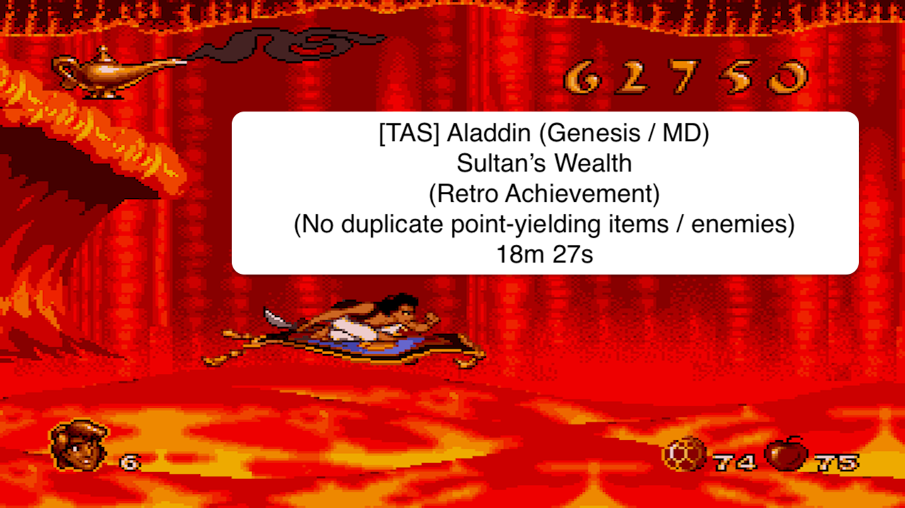

# TAS Aladdin (Genesis / MD)

## Sultan's Wealth (Retro Achievement) in 18:27

My inspirations for this TAS came from :

- [Flip's TAS Any% run](https://www.youtube.com/watch?v=f-rclR7uxHY)
- [Levels' maps](https://vgmaps.de/maps/genesis/aladdin)
- [Forum on src](https://www.speedrun.com/fr-FR/aladdin_genesis/forums)
- Other various videos (like [this one](https://www.youtube.com/watch?v=uDWAkZPBTmg) for hidden heart & lives)

### Publication

### About

The goal of the demoted Retro Achievement [Sultan's Wealth](https://retroachievements.org/achievement/27230)
is to get 100.000 points.

In the comments, the suggested solutions involve farming some points at some specific spots.

I wanted to know if it was possible to reach this amount of points by : 
- collecting only once the point-yielding items
- killing only once the point-yielding ennemies

Yes, it is, and it may be TAS-only (especially because of all the apple slices to get in the Rug Ride level).

Note : The difficulty is set to `Difficult`.

### Points

Here are the items / enemies that give points :

=> 150 points

- apple slice (level 7)
- flute (level 3)
- gem
- genie heart
- life

=> 200 points

- bat (levels 4, 5 & 6)
- snake charmer (level 3)

=> 250 points

- abu token (levels 1, 3 & 5)
- genie token

=> 1.000 points

- genie lamp (level 5)
- half scarab (levels 2 & 3)
- iago (level 9)

### Extra lives

Some lives are just hidden (like the one at the end of the first level), but some others require to idle at a specific
spot or to do some backtracking.

#### Idling at a specific spot

You may already know the life that appear when Aladdin is idling under Mickey Mouse's ears in level 2.
It's not the only one.

[Tako](https://www.youtube.com/watch?v=eiqHDkw8tqs) made a video showing a lot of them.

Note 1 : When one extra-life-in-specific-spot is taken, no more will appear.

Note 2 : In the TAS, I took the one in the first level so the aforementioned "Mickey's life" won't be shown / acquired.

#### With backtracking

Some lives will only appear if a backtracking is done. Those are :

- in level 2, after the first palm tree
- in level 3, before climbing to the Abu token
- in level 3, after the second checkpoint
- in level 4, before encountering the second double chained boulders

### Extra hearts

Some hearts appeared with a bit of backtracking :

- in level 2, after touching the ground near the first checkpoint (5)
- in level 3, before the first zipline (1)

### Lives / Gems / Apples management

#### Lives management

When Aladdin has 9 lives, no more appeared in levels (maximum reached).

The issue is that they give points, so fewer lives, fewer points.

That's why, some intentional deaths occur to decrease the amount of lives to then acquire others.

Intentional deaths are done in all levels except the first, the last and in Rug Ride.

#### Gems management

When Aladdin has 99 gems, no more appeared in levels (maximum reached).

The issue is that they give points, so fewer gems, fewer points.

That's why, a wish is bought to decrease the amount of gems by 10 to then acquire others.

Note : Buying the wish in level 8 seems the best spot in regard to levels 2 and 9 (it would be too late at level 10).

#### Apples management

When Aladdin has 99 apples, no more appeared in levels (maximum reached).

The issue is that, in level 7, apple slices give points only if maximum is not reached, so fewer of them, fewer points.

That's why, in level 6, the maximum of apples at the end of the level has to be less or equals to 22 (as 308 apple
slices (77 apples) are collected).

### Tricks / Glitches

First, HydeTheLoon has written [a nice guide](https://www.speedrun.com/aladdin_genesis/guides/im7or) mentioning some
speed techs and other details.

Here are the additional tricks / glitches that are written across multiple tasvideos authors' notes :

- https://tasvideos.org/1734S (ElectroSpecter -> Skidding & Long Jump)
- https://tasvideos.org/5344S (arandomgameTASer -> Hitbox Sword Extension)
- https://tasvideos.org/6773S (Flip -> Tall Jumps & Skid preservation using Sword Jumps)

### Tracker

- Level 1 : Agrabah Market
    - Points : 3750
    - Total points : 3750

- Bonus Level : Abu in Agrabah
    - Points : 750
    - Total points : 4500

- Level 2 : The Desert
    - Points : 5100
    - Total points : 9600

- Level 3 : Agrabah Rooftops
    - Points : 7100
    - Total points : 16700

- Bonus Level : Abu in Agrabah
    - Points : 750
    - Total points : 17450

- Level 4 : Sultan's Dungeon
    - Points : 4600
    - Total points : 22050

- Level 5 : Cave of Wonders
    - Points : 10800
    - Total points : 32850

- Bonus Level : Abu in the Cave
    - Points : 2000
    - Total points : 34850

- Level 6 : The Escape
    - Points : 6100
    - Total points : 40950

- Level 7 : Rug Ride
    - Points : 48300
    - Total points : 89250

- Level 8 : Inside the Lamp
    - Points : 3600
    - Total points : 92850

- Level 9 : Sultan's Palace
    - Points : 4900
    - Total points : 97750

- Level 10 : Jafar's Palace
    - Points : 2250
    - Total points : 100000

### Routing notes

Note 1 : On genie's slot machine, nothing give points, so the goal is to lose the sooner.

Note 2 : Having Jafar as the first selectable choice on genie's slot machine is random. I've been able to manipulate it
for the level 4 (Jafar directly instead of Apple -> Gem -> Apple -> Jafar by throwing apples and loosing some frames at
the end) but without knowing exactly how the slot machine setup is made. 

Note 3 : On bonus levels with Abu, if no more point-yielding items will appear, an intentional fail will occur before
the end of the level.

#### Level 7

There are 321 apple slices, minus :
- 2 (unreachable) at rock n°4
- 2 (unreachable) at rock n°7
- 1 (unreachable) at rock n°19
- 2 (disappearing) at rock n°19
- 1 (unreachable) at rock n°20
- 2 (unreachable) at rock n°21
- 1 (unreachable) at rock n°22
- 1 (unreachable) at rock n°27
- 1 (unreachable) at rock n°28

Which gives 308 reachable apple slices (= 77 apples).

Additionally :
- 1 life unreachable at rock n°10
- 1 gem unreachable at rock n°13
- 1 life unreachable at rock n°15
- 1 gem unreachable at rock n°17
- 1 genie unreachable at rock n°19 (or 2 slices had to be skipped which represents 50 points lost)
- 1 life unreachable in the end (at rock n°29) (and therefor won't be shown by maxing the number of lives before)

Note : as a life or a gem gives 150 points (as an apple slice), they will be trade for an apple slice if a choice
has to be made.

### Remaining points

Here are the locations of the known remaining points :

- (200 points) Level 5 : At 08:36, this "nest" contains 5 bats but only 4 are killed
- (250 points) Level 5 : At 08:55, the Shiva Monkey boss is skipped and so is the genie token above that can be grabbed
only with the rug it seems (I've tried a lot of attempts to get it without, but no success)
- (450 points) Level 10 : There are 3 hearts grabbable between where the TAS stops and the fight against Jafar
