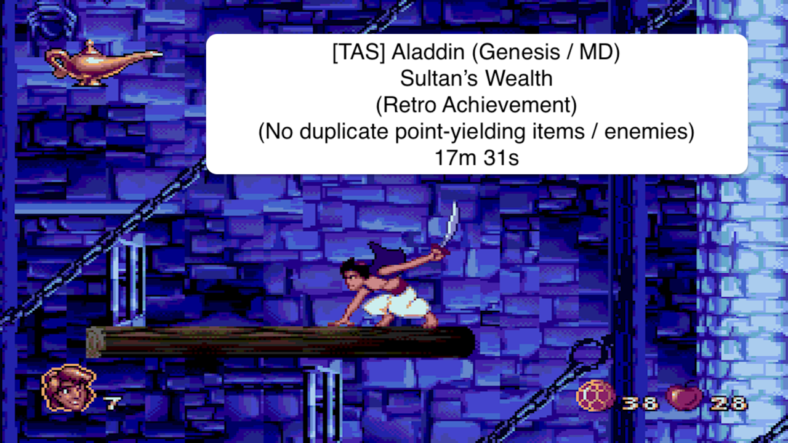

# TAS Aladdin (Genesis / MD)

## Sultan's Wealth (demoted Retro Achievement) in 17:31 (No Duplicate Points)

My inspirations for this TAS came from :

- [Flip's TAS Any% run](https://www.youtube.com/watch?v=f-rclR7uxHY)
- [Levels' maps](https://vgmaps.de/maps/genesis/aladdin)
- [Forum on src](https://www.speedrun.com/fr-FR/aladdin_genesis/forums) (especially "Alternative Cave boss skip")
- Other various videos (like [this one](https://www.youtube.com/watch?v=uDWAkZPBTmg) for a hidden heart & some hidden lives)

---

### Publication

---

### About

The goal of the demoted Retro Achievement [Sultan's Wealth](https://retroachievements.org/achievement/27230)
is to get 100.000 points.

In the comments of the RA page, the suggested solutions involve farming some points at some specific spots.

I wanted to know if it was possible to reach this amount of points by : 
- collecting only once the point-yielding items (gems, genie hearts, lives, ...)
- killing only once the point-yielding ennemies (bats and snake charmers)

Yes, it is, and it may be TAS-only (especially because of all the apple slices to get in the Rug Ride level in one go).

Note : The difficulty is set to `Difficult`.

---

### Points

Here are the items / enemies that give points :

=> 150 points

- apple slice (level 7)
- flute (level 3)
- gem
- genie heart
- life

=> 200 points

- bat (levels 4, 5 & 6)
- snake charmer (level 3)

=> 250 points

- abu token (levels 1, 3 & 5)
- genie token

=> 1.000 points

- genie lamp (level 5)
- half scarab (levels 2 & 3)
- iago (level 9)

---

### Extra lives

Some lives are just hidden, but some others require to idle at a specific spot or to do some backtracking.

#### Idling at a specific spot

You may already know the life that appear when Aladdin is idling under Mickey Mouse's ears in level 2.
It's not the only one.

[Tako](https://www.youtube.com/watch?v=eiqHDkw8tqs) made a video showing a lot of them.

Note : When one extra-life-in-specific-spot is taken, no more will appear.

#### With backtracking

Some lives will only appear if a backtracking is done. Those are :

- in level 2, after the first palm tree
- in level 3, before "zig-zag climbing" to the Abu token
- in level 3, after the second checkpoint
- in level 4, before the first double chained boulders after encountering the second double chained boulders

---

### Extra hearts

Some hearts will appear after a bit of backtracking :

- in level 2, after touching the ground before the first checkpoint (5)
- in level 3, before the first zipline (1)

---

### Lives / Gems / Apples management

#### Lives management

When Aladdin has 9 lives, no more will appear in levels (maximum reached).

The issue is that they give points (except in slot machine), so maximum reached, fewer points.

That's why, some intentional deaths occur to decrease the amount of lives to then acquire some others.

Intentional deaths are done in levels 5, 6 and 8 because a death respawns close to a checkpoint (or the level's start).

#### Gems management

When Aladdin has 99 gems, no more will appear in levels (maximum reached).

The issue is that they give points (except in slot machine), so maximum reached, fewer points.

That's why, a unique wish is bought to decrease the amount of gems by 10 to then acquire some others.

Note : Buying the wish in level 8 seems the best spot in regard to levels 2 and 9 (it would be too late at level 10).

#### Apples management

When Aladdin has 99 apples, no more appeared in levels (maximum reached).

The issue is that, in level 7 (Rug Ride), apple slices give points only if the maximum of apples is not reached,
so maximum reached, fewer points.

That's why, in level 6, the maximum of apples at the end of the level has to be less or equals than 22 (as 308 apple
slices (77 apples) are collected).

---

### Tricks / Glitches

First, HydeTheLoon has written [a nice guide](https://www.speedrun.com/aladdin_genesis/guides/im7or) mentioning some
speed techs and other details.

Here are the additional tricks / glitches that are written across multiple tasvideos authors' notes :

- https://tasvideos.org/1734S (ElectroSpecter -> Skidding & Long Jump)
- https://tasvideos.org/5344S (arandomgameTASer -> Hitbox Sword Extension)
- https://tasvideos.org/6773S (Flip -> Tall Jumps & Skid preservation using Sword Jumps)

When Aladdin is slashing with his scimitar, he has a tiny window of invincible frames.
This glitch is used in some levels but especially in the last one (during the path with chained boulders).

---

### Tracker

- Level 1 : Agrabah Market
    - Points : 3450
        - Abu token count : 1
        - Gem count : 10
        - Genie heart count : 3
        - Genie token count : 5
    - Total points : 3450

- Bonus Level : Abu in Agrabah
    - Points : 600
        - Gem count : 4
    - Total points : 4050

- Level 2 : The Desert
    - Points : 5100
        - Gem count : 10
        - Genie heart count : 7
        - Genie token count : 5
        - Half scarab count : 1
        - Life count : 2
    - Total points : 9150

- Level 3 : Agrabah Rooftops
    - Points : 7100
        - Abu token count : 1
        - Flute count : 6
        - Gem count : 10
        - Genie heart count : 9
        - Genie token count : 5
        - Half scarab count : 1
        - Life count : 3
        - Snake charmer count : 2
    - Total points : 16250

- Bonus Level : Abu in Agrabah
    - Points : 600
        - Gem count : 4
    - Total points : 16850

- Level 4 : Sultan's Dungeon
    - Points : 4600
        - Bat count : 7
        - Gem count : 10
        - Genie heart count : 2
        - Genie token count : 5
        - Life count : 1
    - Total points : 21450

- Level 5 : Cave of Wonders
    - Points : 11000
        - Abu token count : 1
        - Bat count : 24
        - Gem count : 10
        - Genie heart count : 16
        - Genie lamp count : 1
        - Genie token count : 3
        - Life count : 2
    - Total points : 32450

- Bonus Level : Abu in the Cave
    - Points : 2000
        - Bat count : 7
        - Gem count : 4
    - Total points : 34450

- Level 6 : The Escape
    - Points : 5900
        - Bat count : 3
        - Gem count : 10
        - Genie heart count : 15
        - Genie token count : 5
        - Life count : 2
    - Total points : 40350

- Level 7 : Rug Ride
    - Points : 48300
        - Apple slice count : 308
        - Gem count : 3
        - Genie token count : 3
        - Life count : 6
    - Total points : 88650

- Level 8 : Inside the Lamp
    - Points : 3600
        - Gem count : 10
        - Genie token count : 6
        - Life count : 4
    - Total points : 92250

- Level 9 : Sultan's Palace
    - Points : 4900
        - Gem count : 10
        - Genie heart count : 6
        - Genie token count : 6
        - Iago count : 1
    - Total points : 97150

- Level 10 : Jafar's Palace
    - Points : 2850
        - Gem count : 8
        - Genie heart count : 10
        - Life count : 1
    - Total points : 100000

- Total
    - Points : 100000
        - Abu token count : 3
        - Apple slice count : 308
        - Bat count : 41
        - Flute count : 6
        - Gem count : 103
        - Genie heart count : 68
        - Genie lamp count : 1
        - Genie token count : 43
        - Half scarab count : 2
        - Iago count : 1
        - Life count : 21
        - Snake charmer count : 2

---

### Routing notes

Note 1 : On genie's slot machine, nothing give points, so the goal is to lose the sooner.

Note 2 : Having Jafar as the first selectable choice on genie's slot machine is random. I've been able to "manipulate"
it by throwing apples during the levels but without knowing exactly how the slot machine setup is made.

Note 3 : On bonus levels with Abu, an intentional fail will occur before the end of the level when enough points were
collected.

#### Level 2

- At 02:39, jumping (instead of being on the ground when reaching the hidden peddler) avoids to go high in the air.

#### Level 3

- At 03:09, no shortcut is taken (nor the TAS one or the RTA one) because there are some points on the right of the
level.

#### Level 4

- At 05:54, during the TAS, I was able to have no more sound here for the rest of the level. As I've optimized this
level afterward, I hadn't anymore this bug. Possible clue : the two skeletons may have exploded almost at the same time.

- At 06:19, this is a "Tall Jump" (cf Tricks / Glitches).

#### Level 5

- At 07:10 (and 07:40), I do not slash the bat "nest" directly else only 3 of 5 bats will be killed (so fewer points).

- At 07:55, the "Alternative Cave boss skip" (cf Inspirations).

- At 07:59, I need to lose 9 lives else all the lives in level 7 (Rug Ride) can't be acquired.

#### Level 6

- At 09:31, I need to lose a life else all the lives in level 7 (Rug Ride) can't be acquired.

#### Level 7

Legend :

- ungrabbable : apple slice that is "outside" of the "grabbable perimeter" (too low, almost in lava)
- unreachable : apple slice / gem / life not reachable because of the scroll speed and where the previous item was
grabbed
- disappearing : apple slice that appears on the right of the screen but does not reach Aladdin (despawned just before)

There are 321 apple slices, minus :
- 2 (ungrabbable) after rock n°4
- 2 (ungrabbable) after rock n°7
- 1 (unreachable) after rock n°19
- 2 (disappearing) after rock n°19
- 1 (unreachable) after rock n°20
- 2 (ungrabbable) after rock n°21
- 1 (ungrabbable) after rock n°22
- 1 (unreachable) after rock n°27
- 1 (unreachable) after rock n°28

Which gives 308 reachable apple slices (= 77 apples).

Additionally :
- 1 life unreachable after rock n°10
- 1 gem unreachable after rock n°13
- 1 life unreachable after rock n°15
- 1 gem unreachable after rock n°17
- 1 genie unreachable after rock n°19 (or 2 slices had to be skipped which represents 50 points lost)
- 1 life unreachable in the end (after rock n°29) (and therefor won't be shown by maxing the number of lives before)

#### Level 8

- At 12:54, I need to lose 4 lives else all the lives in this level won't appear (maximum reached).

- At 13:10, wish bought else some gems won't appear in level 10 (maximum reached).

#### Level 9

- At 14:18 : There's another "carpet path" which allows to jump higher towards the rope, but I haven't managed it.

- At 14:30 : Acquiring those items then dying is a shortcut rather than another carpet ride.

- At 14:55 : This guard is not killed voluntarily to lose a life later.

- At 15:26 : A carpet ride is mandatory to continue the level, and so, the carpet ride on the left side of the level
is faster than the one in the middle of the level (the last one taken), so losing a life is faster.

- At 15:40 : This is the only active dodge of a point-yielding item as I had taken it before.

- At 15:43 : Palace skip !

---

### Remaining points

Here are the locations of the known remaining (900) points :

- (150 points) Level 1 : At 01:03, the hidden life above the peddler is not taken (too slow to get it)
- (150 points) First level with Abu : At 01:35, the life is skipped (too slow to get it)
- (150 points) Second level with Abu : At 05:15, the life is skipped (too slow to get it)
- (250 points) Level 5 : At 07:55, the Shiva Monkey boss is skipped and so is the genie token above that can be grabbed
only with the rug it seems (I've tried a lot of attempts to get it without, but no success)
- (200 points) Level 6 : At 10:20, this bat is not killed to long jump to the upper path (faster path)
